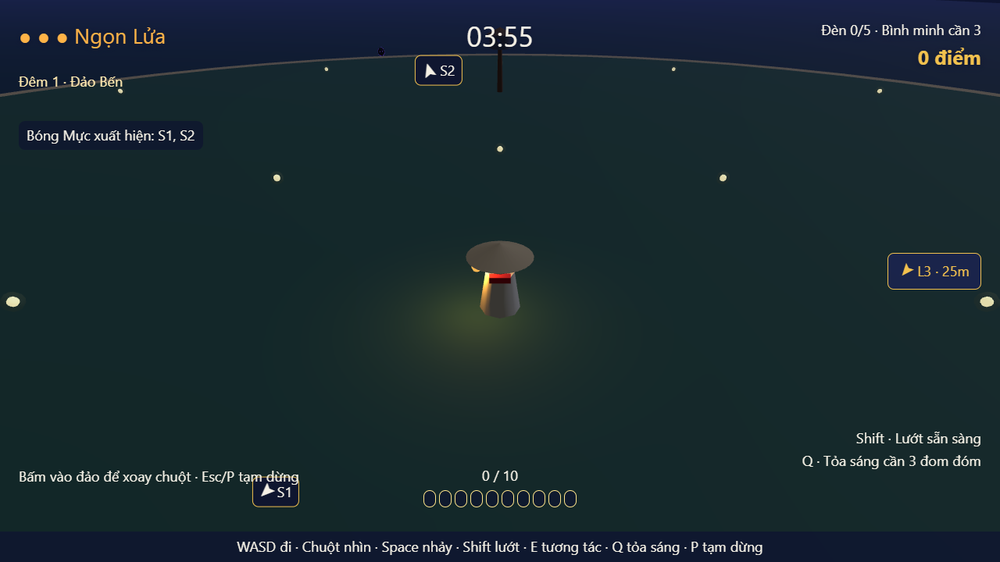

# Đảo Đèn Lồng — v1.0.0 / Phase 4

**Video demo:** chờ tác giả tự quay; [kịch bản và cách đính kèm](docs/demo/README.md). Thay dòng này bằng link MP4/Release công khai trước khi nộp.

Game 3D JavaScript, Three.js, Vite và Node.js. Điều khiển Mây qua ba Đêm, thu đom đóm để thắp và châm dầu, giữ đảo sáng tới bình minh. Headless dùng **Test Contract v1.3**, giữ luật Ticket-03.



## Cài đặt và chơi

Cần **Node.js ≥22.12**, npm và trình duyệt **WebGL2**. Đã kiểm tra Chrome 157, Windows 11, GPU AMD Radeon; máy khác cần tự kiểm tra hiệu năng. Không cần tài khoản, API key hay database.

Clone sạch rồi chạy đúng **3 lệnh** trong thư mục repo:

```sh
npm ci
npm run build
npm start
```

Mở `http://127.0.0.1:4173` → **Bắt đầu** → **Vào Đêm**. PowerShell bị chặn `npm.ps1` có thể dùng `npm.cmd`. Đổi cổng: `npm start -- --port 4180`. Phát triển: `npm run dev` có cùng API bảng điểm. `vite preview` chỉ xem web tĩnh; dùng `npm start` để lưu điểm.

Gói ZIP: giải nén, cài Node rồi chạy **một lệnh** `node scripts/run.mjs`; không cần `npm install`. [Trạng thái bàn giao](docs/phase-4-delivery.md).

## Điều khiển và mục tiêu

| Hành động | Mặc định |
| --- | --- |
| Di chuyển | W / S / A / D |
| Camera | Bấm game để khóa chuột; hoặc giữ chuột phải và kéo |
| Nhảy / lướt | Space / Shift |
| Nạp đom đóm, châm dầu / Tỏa Sáng | E / Q |
| Tạm dừng | P; Esc thả chuột và tạm dừng |

Cài đặt cho đổi cả 9 hành động, báo trùng phím, khôi phục mặc định; lưu phím, âm lượng, độ nhạy, bảng màu dễ phân biệt, giảm chuyển động, chữ lớn ×1.25. UI tối thiểu 18 px ở 1280×720; chữ lớn 22.5 px. Có cảnh báo hướng Bóng Mực mới xuất hiện, gió trước 2 giây, 10 giây cuối và đèn dưới 30 dầu.

Sống tới hết **240 / 270 / 300 giây**, giữ ít nhất **3/5, 4/6, 5/7** đèn sáng ở cuối Đêm tương ứng. Hết Ngọn Lửa luôn thua trước. Thắp hết đèn không thắng sớm. Đèn mới cần 10 đom đóm; thắp lại cần 5. Dầu tối đa 100, hao 1/giây; mỗi con châm thêm 10. Dưới 30 dầu mất vùng an toàn, có thể bị hút thêm 5/giây/con. Sức chứa tăng 2 mỗi lần thắp, tối đa 20, reset mỗi Đêm.

Điểm: +5 mỗi con nạp/châm; +100 thắp đầu, +40 thắp lại; Tỏa Sáng +5 mỗi Bóng Mực, hoặc tổng +15 nếu đang hút dầu. Khi thắng: mỗi đèn sáng +50+floor(dầu), mỗi Ngọn Lửa +50. Tổng hành trình chỉ cộng các Đêm đã thắng; không thưởng thời gian.

Sau khi thua hoặc thắng Đêm 3, nhập tên 3–12 ký tự `[A-Za-z0-9_]` để lưu top 10. Bằng điểm ưu tiên người đạt trước. Server lưu **`data/leaderboard.json`**; giữ thư mục này khi nâng cấp, không commit điểm cá nhân. Menu chính có Bảng xếp hạng. Xuất cùng dữ liệu:

```sh
node scripts/run.mjs --export-leaderboard out.json
```

## Kiểm chứng

```sh
npm test
npm run test:browser
npm run verify:phase1
npm run verify:phase2
npm run verify:phase3
node src/headless/cli.js --seed 7 --night 1 --ticks 14400 --out result.jsonl
```

Headless không cần GPU; hỗ trợ `--inputs`, `--scenario`, `--snapshot-every`, `--night 1|2|3`. JSONL có snapshot tick 0 và dòng `end`. Verifier lưu hồi quy hiện hành dưới `docs/proof/phase-4/`, giữ bằng chứng cũ. Test browser/bench/package cần Chrome cài sẵn; Edge: đặt biến `BROWSER_CHANNEL=msedge`.

```sh
npm run bench -- --seed 42 --duration 30 --out bench.json
npm run soak -- --seed 7 --nights 10 --out soak.json
```

Benchmark mở Chrome thật, vùng vẽ 1280×720, warmup 3 giây rồi đo 30 giây. Đúng 200 Bóng Mực wander, 100 đom đóm, L1–L3 sáng/dầu 100; cùng renderer/ánh sáng gameplay với instancing. Tắt input, spawn, sát thương, pickup, hao dầu và kết thúc; camera bán kính 30 m, cao 15 m, một vòng 15 giây. Không thêm thực thể/hiệu ứng sáng tạo trong cảnh chuẩn.

Web không bảo đảm tắt vsync: **`vsync_off=false`**. RSS riêng renderer đa tiến trình không đo tin cậy: **`peak_mem_mb=null`**. Tải tính từ khởi động tiến trình bench tới khung cảnh đầu. FPS dùng N/tổng dt; 1% low lấy trung bình ceil(0.01N) dt lớn nhất; p95 nearest-rank. Chỉ lấy khoảng frame hoàn toàn trong cửa sổ đo; lưu dt thô/cấu hình trong `bench.json.metadata.json`.

Soak chạy 10 Đêm trong **cùng tiến trình**, xoay 1→2→3, seed 7…16; input đúng xác suất ticket. RSS sau tải Đêm đầu và sau reset cuối, không ép GC. `soak_cmd` dùng Node `--jitless --max-semi-space-size=1 --max-old-space-size=32`: giảm chi phí VM, đổi lại chạy chậm hơn, không đổi luật hay tăng giả baseline. Lần đo trước tối ưu không đạt được giữ tại `docs/proof/phase-4/soak-initial.json`.

Đo tham khảo thật: **120.21 FPS**, 1% low **107.43**, tải **1.37 s**; soak **0 crash**, RSS **40.79→44.78 MiB (+9.8%)**. Kết quả máy giảng viên mới dùng chấm. [Bằng chứng và giới hạn](docs/phase-4-delivery.md).

## Đóng gói, tài liệu và quyền

```sh
npm run package:release
npm run test:package
```

Build trước khi đóng gói. ZIP và SHA-256 ở `release/` (không commit); kiểm tra giải nén sạch, chạy Node-only và WebGL. Hướng dẫn [quay demo](docs/demo/README.md), [commit/tag/Release thủ công](docs/release-commands.md), [release notes](docs/release-notes-v1.0.0.md).

[Changelog](CHANGELOG.md) · [Retro](docs/retro.md) · [AI log](docs/notes/ai-log.md) · [Giả định](docs/notes/assumptions.md) · [ADR](docs/adr/0001-lantern-fuel-and-dawn.md) · [Harness](AGENTS.md) · [README lịch sử](docs/history-readme.md).

Mã game giữ bản quyền, cho xem/chạy/chấm bài theo [LICENSE](LICENSE). Asset/âm thanh tạo bằng code; nguồn và giấy phép thư viện trong [CREDITS.md](CREDITS.md), [THIRD_PARTY_NOTICES.txt](THIRD_PARTY_NOTICES.txt).

## Sáng tạo của tôi

Mây đội nón lá, mang đèn nhỏ và đảo/đèn giấy dựng bằng hình học procedural; nhạc và hiệu ứng tự tổng hợp Web Audio. Các chi tiết trình bày không thêm luật, sự kiện hay thực thể headless. Ảnh gameplay phía trên là bằng chứng hình ảnh. Benchmark tắt âm thanh, không thêm hiệu ứng/nhân vật ngoài cảnh chuẩn.
